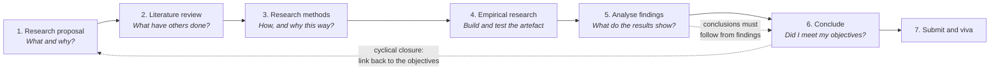
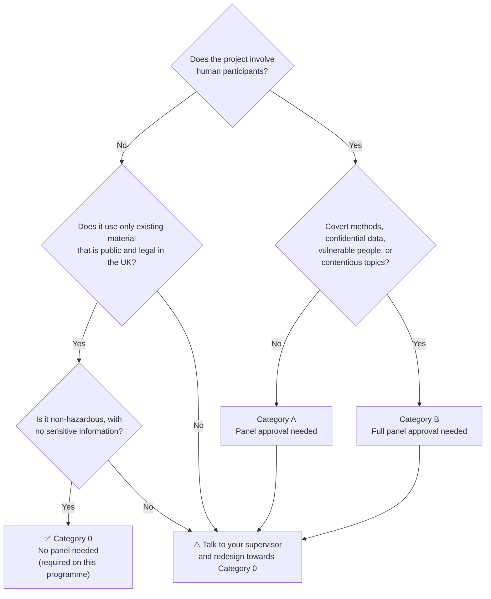

# 7CS077/UZ1: Master’s Dissertation

> **Quick facts**
>
> - **Duration:** 15 weeks of study, with the final assessment in Week 16
> - **Assessment:** one assessment in two parts: Project Proposal (15%) and Dissertation (85%)
> - **Proposal due:** end of Week 8
> - **Communication:** e-mail, announcements, and discussion forums
> - **Support:** your associate lecturer and your supervisor

---

## Table of Contents

1. [Module Overview](#module-overview)
2. [Course Schedule](#course-schedule)
3. [Module Learning Outcomes](#module-learning-outcomes)
4. [Assessment Guide](#assessment-guide)
   - [Part 1: Project Proposal (15%)](#part-1-project-proposal-15)
   - [Part 2: Dissertation (85%)](#part-2-dissertation-85)
   - [Required Forms and Resources](#required-forms-and-resources)
5. [Weekly Notes](#weekly-notes)
   - [Week 1: The Master’s Dissertation](#week-1-the-masters-dissertation)
   - [Week 2: Submitting a Research Proposal](#week-2-submitting-a-research-proposal)
   - [Week 3: Preparing for Your Dissertation](#week-3-preparing-for-your-dissertation)
   - [Week 4: Plagiarism and Referencing](#week-4-plagiarism-and-referencing)
   - [Week 5: Becoming a Critical Reader and Writer](#week-5-becoming-a-critical-reader-and-writer)
   - [Week 6: The Dissertation Introduction](#week-6-the-dissertation-introduction)
   - [Week 7: Developing an In-Depth Analysis](#week-7-developing-an-in-depth-analysis)
   - [Week 8: The Literature Review](#week-8-the-literature-review)
   - [Week 9: Building Up Your Critical Literature Review](#week-9-building-up-your-critical-literature-review)
   - [Week 10: Research Methods](#week-10-research-methods)
   - [Week 11: Advanced Writing Skills](#week-11-advanced-writing-skills)
   - [Week 12: Concluding Your Dissertation](#week-12-concluding-your-dissertation)
   - [Week 13: Writing the Abstract](#week-13-writing-the-abstract)
   - [Week 14: Adding a Professional Touch](#week-14-adding-a-professional-touch)
   - [Week 15: Good and Bad Practice](#week-15-good-and-bad-practice)
   - [Week 16: Final Assessment](#week-16-final-assessment)

---

## Module Overview

### What the module covers

This module is about the Master’s Dissertation. You will learn:

- what a Master’s Dissertation is, what it involves, and how it is assessed;
- how to write the project proposal;
- how to read literature critically and do the background reading;
- how to structure each chapter, from the introduction to the conclusion;
- best practices for writing the dissertation;
- how to make the most of the support and advice available from your supervisor.

### How the module works

- **Sequence:** the module runs in order, week by week. Work through each week in order as a class, following the course schedule.
- **Materials:** reading, lectures, dissertation milestones, quizzes, and discussion forums.
- **Submissions:** all activities are submitted digitally.
- **Communication:** e-mail, announcements, and discussion forums.
- **Guidance:** your associate lecturer will guide you through the module.

---

## Course Schedule

| Week | Topic | Milestone |
|:----:|-------|-----------|
| 1 | [The Master’s Dissertation](#week-1-the-masters-dissertation) ✅ | Milestone 0: contact your supervisor |
| 2 | [Submitting a Research Proposal](#week-2-submitting-a-research-proposal) | **Ethical Considerations Form due** |
| 3 | [Preparing for Your Dissertation](#week-3-preparing-for-your-dissertation) | |
| 4 | [Plagiarism and Referencing](#week-4-plagiarism-and-referencing) | |
| 5 | [Becoming a Critical Reader and Writer](#week-5-becoming-a-critical-reader-and-writer) | |
| 6 | [The Dissertation Introduction](#week-6-the-dissertation-introduction) | |
| 7 | [Developing an In-Depth Analysis](#week-7-developing-an-in-depth-analysis) | |
| 8 | [The Literature Review](#week-8-the-literature-review) | **Project Proposal due (end of week)** |
| 9 | [Building Up Your Critical Literature Review](#week-9-building-up-your-critical-literature-review) | |
| 10 | [Research Methods](#week-10-research-methods) | |
| 11 | [Advanced Writing Skills](#week-11-advanced-writing-skills) | |
| 12 | [Concluding Your Dissertation](#week-12-concluding-your-dissertation) | |
| 13 | [Writing the Abstract](#week-13-writing-the-abstract) | |
| 14 | [Adding a Professional Touch](#week-14-adding-a-professional-touch) | |
| 15 | [Good and Bad Practice](#week-15-good-and-bad-practice) | |
| 16 | [Final Assessment](#week-16-final-assessment) | **Dissertation submission** |

---

## Module Learning Outcomes

Each weekly outcome below is tagged with the module learning outcome (MLO) it supports.

- **MLO1:** Demonstrate a deep and systematic understanding of a selected specialist area of your master’s subject course, including issues at the forefront of research or professional practice in that area.
- **MLO2:** Independently design and undertake a substantial investigation that rigorously tackles a complex problem in the master’s subject of your course, selecting appropriate methodological processes and critically evaluating their effectiveness.

---

## Assessment Guide

There is **one assessment** for this module, made up of **two parts**. Marking uses the rubrics on the assignment page.

| Part | Deliverable | Weight | Length | Due |
|------|-------------|:------:|--------|-----|
| 1 | Project Proposal | 15% | 1,000 words (± 10%) | End of Week 8 |
| 2 | Dissertation (thesis) | 85% | 7,000 words (± 10%) | Week 16 |

### Part 1: Project Proposal (15%)

Your proposal should cover:

1. The **problem statement**.
2. The **aims and objectives** of the project.
3. An **outline of a testable artefact**, such as software, a process, or a procedure.
4. The **methodology** you will use.
5. The **resources** the artefact needs.
6. Any **ethical issues**.
7. Relevant and comprehensive **primary and secondary research** to support the project.

### Part 2: Dissertation (85%)

Your dissertation should clearly describe the artefact you designed, developed, and tested, with scientific evidence. It is assessed on:

- **Quality of analysis**: originality and depth.
- **Research conducted**: including the references used.
- **Overall presentation**: structure and clarity.

### Required Forms and Resources

All of these are available on the module’s Canvas page. Replace each `#` with the Canvas link.

- [ ] [Project Proposal brief](#)
- [ ] [Dissertation brief](#)
- [ ] [Project Handbook](#)
- [ ] [Ethical Considerations form](#): complete it and submit it to the portal.
- [ ] [Learning Agreement](#)
- [ ] [Marking rubrics](#), on the assignment page

---

## Weekly Notes

### Week 1: The Master’s Dissertation

> **Status:** ✅ Completed
>
> **This week’s milestone:** Milestone 0, Project Commencement & Supervisor Discussion.
>
> **Coming up:** Ethical Considerations Form due at the end of Week 2.

#### Learning outcomes

1. Describe the purpose of a master’s dissertation (MLO2).
2. Explain how master’s dissertations are evaluated (MLO2).
3. Identify the skills needed to successfully complete a master’s dissertation (MLO2).
4. Revise a master’s dissertation research proposal (MLO1).

#### Activities

| Type | Activity | When |
|------|----------|------|
| 📖 Read | Chapter 1 of *Succeeding With Your Master’s Dissertation* | Early in the week |
| 🎥 Watch | Micro-lecture: The Master’s Dissertation | Early in the week |
| ⚖️ Ethics | Discuss the project with your supervisor and start the Ethical Considerations Form | Submit by end of Week 2 |
| 🚩 Milestone 0 | E-mail your supervisor, introduce yourself, and share project ideas | This week |

#### Summary

**1. What a master’s dissertation is**

- At its simplest, it is a **long, structured essay** on a topic of your choice.
- In practice, it is an **independent piece of research**, written up within a fixed timeframe and word limit.
- To count as research, it must be **systematic**. You must:
  1. identify your topic;
  2. set clearly defined objectives;
  3. explain how you will meet them;
  4. carry out the research;
  5. analyse the findings;
  6. conclude against what you set out to do, adding recommendations or implications where relevant.
- Research gives **new insight** into a topic, or new ways of looking at or doing something.
- Dissertations differ by subject and department. Some are literature-based, some collect data (e.g. interviews), and some create an **artefact** (e.g. software) or run an experiment. A Computer Science dissertation usually builds and tests an artefact.

**2. How it is evaluated**

- The dissertation is a **test of whether you can complete a research project on your own**, following a process the academic community accepts.
- Markers look for evidence in your **chapters**, which should cover each stage of the project from start to finish. The project ends with a **presentation (viva)** where you defend your work to your supervisor and a reader.
- Typical questions markers ask:
  - Are the research objectives appropriate, focused, clear, and achievable?
  - Is the research placed in context and justified?
  - Is the student well read in the area, and is there evidence of critical thinking?
  - Are the research methods valid and reliable?
  - Is there an understanding of ethical issues?
  - Have the findings been described, analysed, and synthesised?
  - Do the conclusions follow from the findings?
  - Have recommendations or implications been identified?
  - What contribution does the work make?
- **The process matters more than the result.** You don’t get marks for earth-shattering conclusions. You get marks when:
  - your conclusions follow from your findings;
  - your findings come from properly applied research methods;
  - your methods were chosen because they suit your objectives;
  - all of this is **transparent** to the marker.
- **Answer “what” and “why” at every key point.** The *why* is what earns marks. For example: “I used **8 epochs** because I tested both fewer and more during development, and 8 gave the best results.” This shows the value wasn’t pulled out of thin air.

**3. Skills and qualities you need**

| Category | Skill or quality | In practice |
|----------|------------------|-------------|
| Generic skills | Time management | Book regular time slots, so the dissertation becomes routine rather than a task you keep putting off |
| | Organisation | Keep a disciplined structure, plan library visits, and arrange supervisor meetings |
| | Communication | Keep it simple, clear, and relevant |
| | Listening | When your supervisor suggests changing something, they are telling you how to gain marks and avoid losing them |
| | Technology | Use library databases and referencing software, and **back up your work** |
| | Independent learning | You lead; your supervisor advises |
| | Presentation | Practise presenting to friends and your supervisor before the viva |
| Research skills | Writing each chapter | Proposal, abstract, introduction, literature review, methods (including ethics), findings, and conclusion, all in the language of academic discourse |
| Personal qualities | Self-motivation | Stay curious and positive over a long period |
| | Self-confidence | Your views on published work are valid, as long as evidence supports them |
| | Self-centredness | Tell the people close to you that the dissertation is a priority |

**4. Project ethics**

- Every project must be reviewed against ethical research principles. Discuss your study with your supervisor and complete the **Ethical Considerations Form** as early as possible, by the **end of Week 2** at the latest.
- **All projects on this programme must be Category 0**, so they don’t need approval from an ethics panel.
- The form asks whether your project involves **human participants, data about humans, or sensitive information**. If any answer is *yes*, you must complete page 2 of the form.

| Category | What it means | Ethics panel needed? |
|----------|---------------|:--------------------:|
| **0** | Non-hazardous, no participants, and uses only existing material that is publicly and legally available in the UK | No, and this is **required on this programme** |
| **A** | Involves people, but isn’t hazardous to them or the researcher, and doesn’t involve vulnerable people | Yes |
| **B** | Higher risk, e.g. covert procedures, highly confidential data, vulnerable participants, or offensive or contentious topics | Yes, and undergraduates can’t do these |

> **Remember:** if your proposal changes significantly after the ethics review, tell your supervisor straight away. The changes may need a new review.

#### Visual summary

**The module milestones (Milestone 0 is this week):**

**The dissertation life cycle, and what markers check at each stage:**

**Which ethical category is my project in?**

> **Tip:** VS Code’s built-in preview doesn’t draw Mermaid diagrams. Install the *Markdown Preview Mermaid Support* extension to see them. GitHub draws them automatically.

#### Related files

| File | Type | What it covers | When to use it |
|------|------|----------------|----------------|
| [7CS077 - Week 1-Slides.pdf](<MD_Module_Weekly_Docs/7CS077 - Week 1-Slides.pdf>) | Lecture slides (26 pages) | What a dissertation is, how it is marked, the skills needed, and the life cycle | Revising the Week 1 content |
| [1_Milestone_0_Project_Commencement_&_Supervisor_Discussion.png](<MD_Module_Weekly_Docs/1_Milestone_0_Project_Commencement_&_Supervisor_Discussion.png>) | Image | Timeline of Milestones 0 to 7 across Weeks 1 to 16 | Planning your weekly workload |
| [Ethical_Considerations_Form_v1.1.docx](<MD_Module_Weekly_Docs/Ethical_Considerations_Form_v1.1.docx>) | Form (Word) | Project registration and ethics checklist (participants, privacy, animals, dual use) | Fill in and submit by **end of Week 2** |
| [Ethical-Categories.pdf](<MD_Module_Weekly_Docs/Ethical-Categories.pdf>) | Guidance (1 page) | Definitions of Categories 0, A, and B | Checking that your project is Category 0 |
| [Handbook-for-Ethical-Review-&-Approval-2025-2026.pdf](<MD_Module_Weekly_Docs/Handbook-for-Ethical-Review-&-Approval-2025-2026.pdf>) | University handbook (15 pages) | Why ethical review exists, which considerations trigger full review, and the application process | Background reading on research ethics |

#### Conclusion

A master’s dissertation is a test of research process, not a hunt for a ground-breaking result. If your objectives are clear, your methods are justified, your conclusions follow from your evidence, and your project is ethical, you can earn high marks even with a modest finding. These real-world cases show the same ideas:

1. **Justify every choice (the “why”).** In *Attention Is All You Need* (Vaswani et al., 2017), the paper that introduced the Transformer, the authors don’t just state their model settings. They include a table of experiments that vary the number of attention heads, layer sizes, and dropout, showing the effect of each. This is the 8-epochs advice at a larger scale: evidence for each value, not just the value.

2. **The process is what makes results trustworthy.** Many machine learning results have been hard to reproduce, because papers left out details such as hyperparameters, data splits, or random seeds. In response, NeurIPS, one of the largest AI conferences, introduced a reproducibility checklist for submissions in 2019. Markers apply the same test to your dissertation: could someone follow your chapters and get the same result?

3. **Participants without consent are an ethics failure.** In the Facebook “emotional contagion” study (Kramer et al., 2014, *PNAS*), the news feeds of about 689,000 users were changed without their informed consent. The journal later published an editorial expression of concern. Under the university’s rules, this would be Category B, because it used covert procedures. This is why your project must have no participants.

4. **Data about people is still sensitive, even when it is easy to get.** In the Cambridge Analytica scandal (2018), a personality-quiz app built by an academic collected data on up to 87 million Facebook users, most of whom had never used the app. That data was then reused for political targeting. The UK Information Commissioner’s Office fined Facebook £500,000. This is the kind of reuse that the form’s questions on “data about humans” and “privacy” are meant to catch.

5. **“Publicly available” doesn’t automatically mean “ethical”.** MIT took its *80 Million Tiny Images* dataset offline in 2020, after researchers (Prabhu & Birhane) found offensive and derogatory labels in it. When you choose a public dataset for a Category 0 project, check how it was collected and labelled, and say so in your methods chapter.

**Next week:** research proposals: their purpose and content, aims versus objectives, research methods, and research ethics.

---

### Week 2: Submitting a Research Proposal

**Learning outcomes**

1. Summarise the purpose and content of a research proposal (MLO2).
2. Describe research aims and objectives, and the differences between them (MLO2).
3. Discuss research methods and their key aspects (MLO2).
4. Discuss research ethics, its importance, and its core principles (MLO2).

**Notes**

-

---

### Week 3: Preparing for Your Dissertation

**Learning outcomes**

1. Explain the roles and responsibilities of both student and supervisor (MLO2).
2. Apply tutor feedback to your project and thesis (MLO2).
3. Discuss potential issues with research projects, and their solutions (MLO2).

**Notes**

-

---

### Week 4: Plagiarism and Referencing

**Learning outcomes**

1. Explain plagiarism and its consequences (MLO2).
2. Apply referencing to your academic writing (MLO2).
3. Successfully apply a referencing tool to your dissertation (MLO2).

**Notes**

-

---

### Week 5: Becoming a Critical Reader and Writer

**Learning outcomes**

1. Synthesise review questions to analyse academic material (MLO2).
2. Evaluate the usefulness of academic material in the context of your research (MLO2).
3. Identify the conclusions, and the justification of arguments, in academic material (MLO2).
4. Discuss what makes an argument convincing in academic material (MLO2).

**Notes**

-

---

### Week 6: The Dissertation Introduction

**Learning outcomes**

1. Explain the general structure of a dissertation introduction (MLO2).
2. Discuss how to devise overall research aims and individual research objectives (MLO2).
3. Outline research methods and timescales (MLO2).
4. Describe the value of your research (MLO2).

**Notes**

-

---

### Week 7: Developing an In-Depth Analysis

**Learning outcomes**

1. Use a structured approach to evaluate an academic text (MLO2).
2. Successfully apply the ten critical questions to your work (MLO2).
3. Explain how to structure a critical review of a text (MLO2).

**Notes**

-

---

### Week 8: The Literature Review

> **Milestone:** Project Proposal due at the end of this week.

**Learning outcomes**

1. Explain the structure of a literature review (MLO2).
2. Describe the difference between description and critical evaluation (MLO2).
3. Explain the language of academic discourse (MLO2).

**Notes**

-

---

### Week 9: Building Up Your Critical Literature Review

**Learning outcomes**

1. Explain what makes a literature review critical (MLO2).
2. Explain different critical literature review structures and their applications (MLO2).
3. Identify the features of high-quality literature reviews (MLO2).

**Notes**

-

---

### Week 10: Research Methods

**Learning outcomes**

1. Explain research strategies, and how to structure the chapter (MLO2).
2. Discuss techniques for data collection and analysis in research (MLO2).
3. Identify limitations and potential hurdles in research (MLO2).

**Notes**

-

---

### Week 11: Advanced Writing Skills

**Learning outcomes**

1. Use citations and quotes effectively in academic writing (MLO2).
2. Use tables, figures, and appendices effectively in academic writing (MLO2).
3. Discuss good standards of academic writing (MLO2).

**Notes**

-

---

### Week 12: Concluding Your Dissertation

**Learning outcomes**

1. Explain the purpose of a conclusion in an academic dissertation (MLO2).
2. Identify the key requirements of a good conclusion (MLO2).
3. Discuss the importance of acknowledging any academic research contributions (MLO2).

**Notes**

-

---

### Week 13: Writing the Abstract

**Learning outcomes**

1. Explain what an abstract is, and its purpose in academic writing (MLO2).
2. Identify the key requirements of a good abstract (MLO2).
3. Explain the basic structure of an abstract (MLO2).

**Notes**

-

---

### Week 14: Adding a Professional Touch

**Learning outcomes**

1. Describe additions that make a dissertation easier to read (MLO2).
2. Apply abbreviation lists to your dissertation (MLO2).
3. Use a glossary in your dissertation (MLO2).
4. Write a simple index for your dissertation (MLO2).

**Notes**

-

---

### Week 15: Good and Bad Practice

**Learning outcomes**

1. Explain good practices to adopt and bad practices to avoid (MLO2).
2. Discuss dissertation writing tips (MLO2).
3. Recognise the strengths and limitations of dissertations (MLO2).

**Notes**

-

---

### Week 16: Final Assessment

> **Milestone:** Dissertation submission.

**Notes**

-

---

[Back to top](#table-of-contents)
