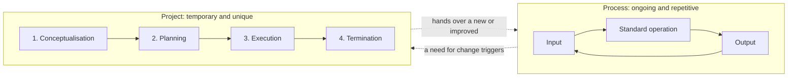
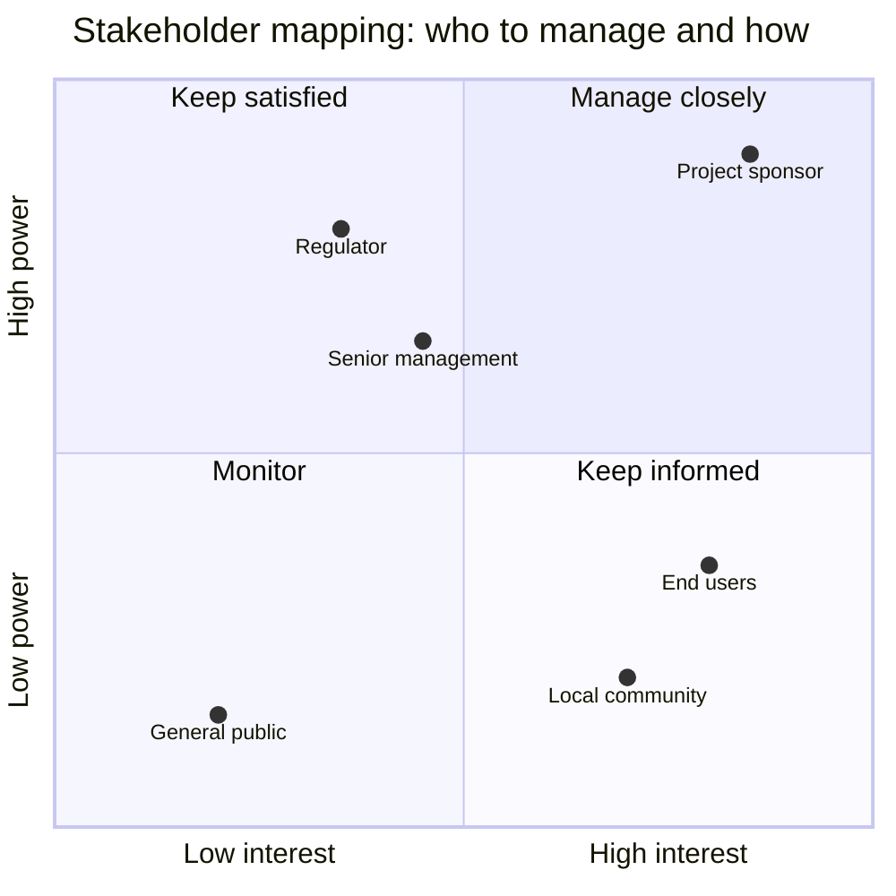
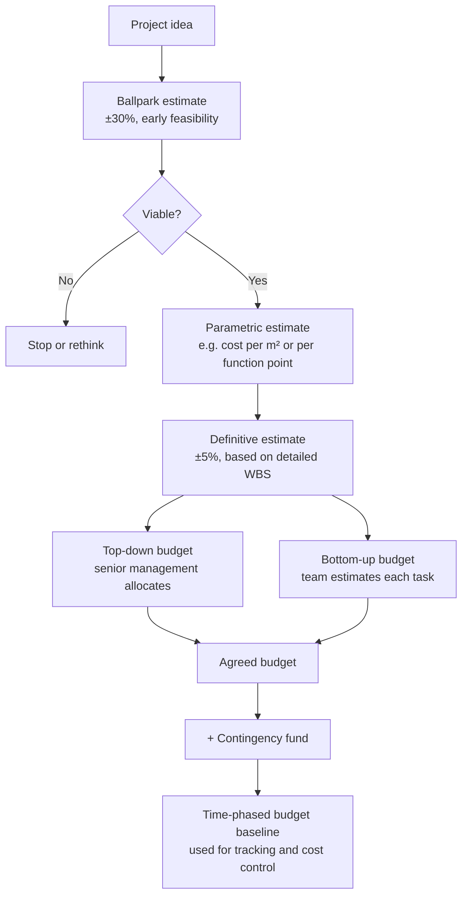
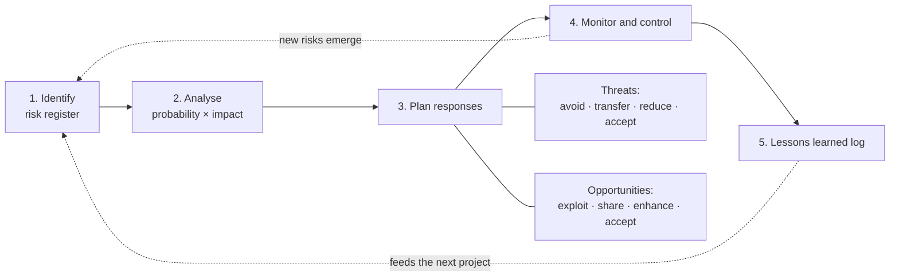
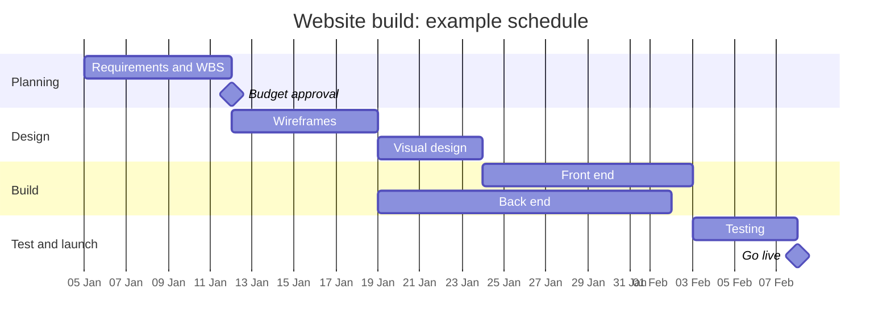
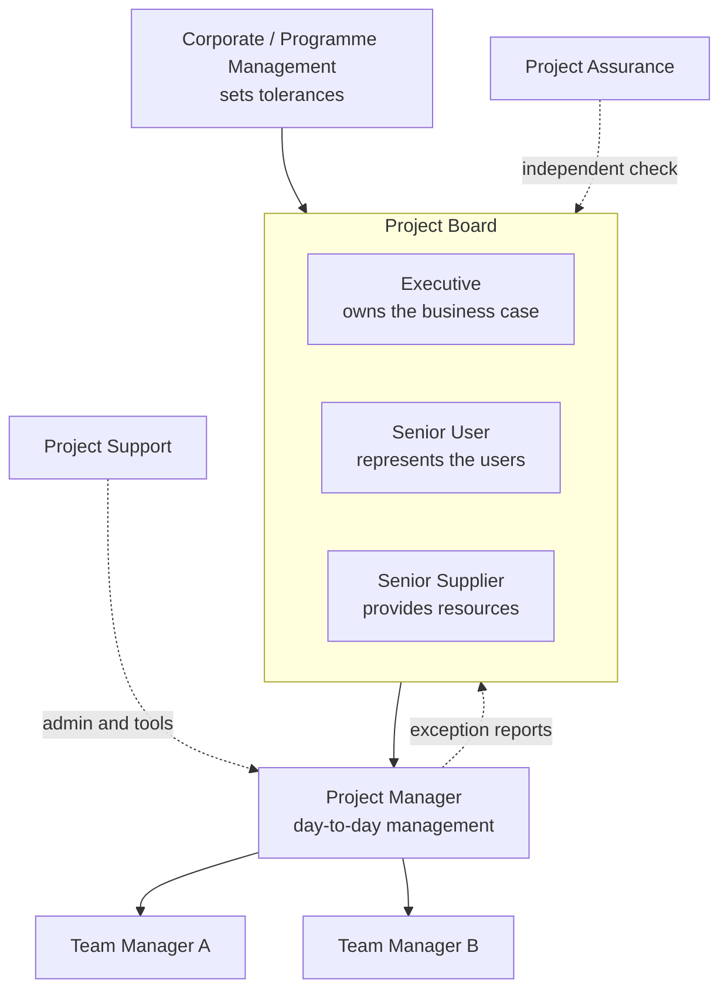
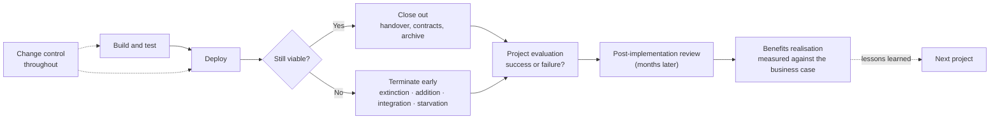

# 7CS076/UZ2: Project Management

**Instructor:** Dr. Ali Al Shakarchi

---

## Table of Contents

1. [Module Overview](#module-overview)
   - [Module Learning Outcomes](#module-learning-outcomes)
   - [Weekly Schedule at a Glance](#weekly-schedule-at-a-glance)
   - [How the Module Works](#how-the-module-works)
   - [Module Documents and Templates](#module-documents-and-templates)
2. [Week 1 – An Introduction to Project Management](#week-1--an-introduction-to-project-management)
3. [Week 2 – The Business Case](#week-2--the-business-case)
4. [Week 3 – Cost Estimation and Budgeting](#week-3--cost-estimation-and-budgeting)
5. [Week 4 – Managing Risks](#week-4--managing-risks)
6. [Week 5 – Planning, Budgeting and Scheduling](#week-5--planning-budgeting-and-scheduling)
7. [Week 6 – Project Governance](#week-6--project-governance)
8. [Week 7 – Project Closure and Termination](#week-7--project-closure-and-termination)
9. [Module Conclusion](#module-conclusion)

> Each week includes **Lecture Summaries** (L1.1 to L7.10) below its micro-lecture table, and ends with a **diagram** (written in Mermaid) and a **conclusion with real-life examples**. Diagrams render on GitHub and in VS Code with a Mermaid preview extension (e.g., *Markdown Preview Mermaid Support*).

---

## Module Overview

### Module Learning Outcomes

At the end of this module, you will be able to:

- **MO1:** Develop critical evaluation and understanding of knowledge on various methodologies underpinning core project management processes and procedures, to assure project success and minimise risk.
- **MO2:** Flexibly and autonomously apply knowledge on solutions and processes that underpin professional practice in project management.

Weekly learning outcomes (WO) are listed within each week below.

### Weekly Schedule at a Glance

| Week | Topic                                                                                  | Lecture files | Feeds the assessment? |
| ---- | -------------------------------------------------------------------------------------- | ------------- | --------------------- |
| 1    | [An Introduction to Project Management](#week-1--an-introduction-to-project-management) | L1.1 – L1.4  | No                    |
| 2    | [The Business Case](#week-2--the-business-case)                                         | L2.1 – L2.5  | Yes                   |
| 3    | [Cost Estimation and Budgeting](#week-3--cost-estimation-and-budgeting)                 | L3.1 – L3.4  | Yes                   |
| 4    | [Managing Risks](#week-4--managing-risks)                                               | L4.1 – L4.5  | Yes                   |
| 5    | [Planning, Budgeting and Scheduling](#week-5--planning-budgeting-and-scheduling)        | L5.1 – L5.5  | Yes                   |
| 6    | [Project Governance](#week-6--project-governance)                                       | L6.1 – L6.5  | Yes                   |
| 7    | [Project Closure and Termination](#week-7--project-closure-and-termination)             | L7.1 – L7.10 | No                    |

> **Assessment tip:** Weeks 2 to 6 feed directly into the final assessment, and you will be graded on them in your submission. It is prudent to work on each section of the report while you are studying the related topics.

### How the Module Works

Over seven weeks, this module introduces the idea of managing by projects, and will help you to manage and control the projects you are involved in. Past graduates who went on to vocational courses such as PRINCE2 found them easy to understand, and their tutors commented on how well prepared they were. If you continue in project management professionally, this module puts you in a very good starting position.

**Weekly structure**

1. **Read** – complete the required readings early in the week; they help you respond to the discussion questions and complete your assignment.
2. **Watch** – work through the micro-lectures (PowerPoint with voiceover), in order, early in the week. They may direct you to a discussion, a Canvas post or a chapter reading.
3. **Discuss and do** – join the discussions and activities, and save the tools provided for future use.
4. **Quiz** – take the weekly quiz after the lectures, readings and discussions.

**Weekly quizzes**

- They are not marked towards your final grade, but they give you feedback.
- You can attempt them as many times as you like, and you may search the internet for prompts.
- Only your final attempt is visible to staff, as an indication of engagement.

**Communication skills**

- Project management is all about communicating.
- The module gives you a supportive environment to practise small presentations, discussions and report writing; useful preparation for work, or for a job interview.

**The assignment**

- It is your opportunity to demonstrate the knowledge you have gained; full details are in the Canvas topic.
- Always read the marking criteria as a guide to what is expected, and ask for clarification if you are uncertain, so you don't waste effort.

**Academic skills**

- Use citations when making a statement, and check the credibility and accuracy of your sources (see the CARS lecture, [L1.4](<PM_Module_Docs/L1.4%20CARS.pdf>)).
- Academic skills guides are linked in [Week 2](#week-2--the-business-case) and below.

### Module Documents and Templates

All files are in [PM_Module_Docs/](PM_Module_Docs/).

**Templates (assessment)**

- [7CS076 Project Mandate Template](<PM_Module_Docs/7CS076%20Project%20Mandate%20Template.docx>)
- [Risk Management Process Template](<PM_Module_Docs/Risk%20Management%20Process%20Template.docx>) – Week 4
- [Risk Register Template](<PM_Module_Docs/Risk%20Register%20-%20Template.xlsx>) – Week 4

**Case studies and readings**

- [Nxt Day Business Mail Case Study](<PM_Module_Docs/Nxt%20Day%20Business%20Mail%20Case%20Study.pdf>) – Weeks 2 and 6
- [Example case study: University of Atlantis (investment appraisal)](<PM_Module_Docs/investmt%20appraisal%20case%20study.docx>) – Week 3
- [Overview of Economic Valuation Methods](<PM_Module_Docs/Economic%20Valuation%20Methods.pdf>) – Week 3
- [Health and Safety Principles for Project Managers](<PM_Module_Docs/Health%20and%20safety%20principles%20for%20Health%20and%20safety%20principles%20for%20PROJECT%20MANAGERS.pdf>) – Week 4

**Academic skills guides**

- [LS001 – Guide to Editing and Proofreading](PM_Module_Docs/LS001---Guide-to-Editing-and-Proofreading.pdf)
- [LS007 – Guide to Planning your Assignment](PM_Module_Docs/LS007-Guide-to-Planning-your-Assignment.pdf)
- [LS012 – Guide to Academic Writing](PM_Module_Docs/LS012---Guide-to-Academic-Writing.pdf)
- [LS013 – Guide to Finding Information](PM_Module_Docs/LS013-Guide-to-Finding-Information.pdf)
- [LS119 – Introduction to Critical Writing](PM_Module_Docs/LS119---Introduction-to-Critical-Writing.pdf)

---

## Week 1 – An Introduction to Project Management

### 1.0 Outcomes and Activities

**Weekly learning outcomes.** At the end of this week, you will be able to:

1. Define a project (MO1, MO2).
2. State why projects are used (MO1, MO2).
3. Discuss the differences between process and project (MO1, MO2).
4. Identify the need for projects in organisations (MO1, MO2).
5. Give examples of projects (MO1, MO2).

**Read** (due early in the week)

- *Required:* Chapter 1 of Pinto, J. (2020) *Project Management: Achieving Competitive Advantage* (WO1–5).
- *Suggested:*
  - AXELOS (2009) *Managing Successful Projects with PRINCE2™* (WO1–5).
  - Harvard Referencing – Cite Them Right: [https://www.citethemrightonline.com/](https://www.citethemrightonline.com/)
  - Reflective Writing Guide.

**Watch** (due early in the week)

| # | Micro-lecture                                           | WO   | File                                                                     |
| - | ------------------------------------------------------- | ---- | ------------------------------------------------------------------------ |
| 1 | Introduction to Project Management                      | 1–5 | [L1.1 Introduction](<PM_Module_Docs/L1.1%20Introduction.pdf>)             |
| 2 | Brief description of the project structure              | 1, 3 | [L1.2 Project Structure](<PM_Module_Docs/L1.2%20Project%20Structure.pdf>) |
| 3 | The Project Manager                                     | 2, 4 | *(no file – L1.3)*                                                    |
| 4 | Credibility, Accuracy, Reliability and Supported (CARS) | 2, 4 | [L1.4 CARS](<PM_Module_Docs/L1.4%20CARS.pdf>)                             |

### Lecture Summaries

#### L1.1 Introduction to Project Management

- **Definition:** a project is a resource-bound process to achieve benefits through a pre-defined, preferred outcome, constrained by time, cost, quality and scope. PMBoK: *"a temporary endeavour undertaken to create a unique product or service."*
- **Why projects?** An organisation has an issue to resolve; a temporary project structure is set up, the benefits are handed over to Business as Usual (BAU), and the project closes.
- **Process vs project:**

  | Process | Project |
  |---------|---------|
  | Repeats a process or product | Creates a new process or product |
  | Several objectives, ongoing | One objective, limited life |
  | Consistent people, existing systems | Diverse people; systems must be created |
  | Performance, cost and time known | Performance, cost and time less certain |
  | Part of the line organisation; supports the current situation | Outside the line organisation; changes the current situation |

- **Where projects come from:** internal and external stakeholders, customers (over half of innovative ideas, per Goffin and Mitchell, 2010), legislation, innovation, and business problems.
- **Examples:** the Channel Tunnel (1988–1994), Windows Vista, the pyramids, the Great Wall of China, and the Manhattan Project, often seen as the first use of "modern" project management.

#### L1.2 Brief Description of the Project Structure

- **Ideas first:** steam power, electricity, cars, computers and mobile phones all started as small, unproven, single projects.
- **Scope:** the work to be done, the business need, links to other projects, stakeholders, and what is *out* of scope.
- **Objectives:** technical, schedule, cost and special objectives, defined benefits, and explicit non-goals.
- **Deliverables:** the products or services, client requirements, benefits realisation, and how success will be measured.
- **Success factors:** satisfied stakeholders, objectives met, on budget, on time, and measurable benefits gained.
- **Team roles:** project manager, planner, finance, risk manager, configuration librarian, administrative assistant.
- **Resources:** people, equipment, locations, outsourced services and suppliers.
- **The plan also covers:** cost analysis, a schedule with milestones (planning → approval → implementation → testing), a risk management plan (risk, probability, impact, owner, mitigation), and quality management with performance measures. These must be planned in from the beginning.
- **Tip:** DYA, "define your acronyms!"

#### L1.3 The Project Manager

- No slide file is available in [PM_Module_Docs/](PM_Module_Docs/).

#### L1.4 Credibility, Accuracy, Reliability and Supported (CARS)

- **Critical reading** means making judgements about a text; criticism can be positive as well as negative, but you must be able to explain your judgement.
- **CARS checklist** for evaluating sources:
  1. **Credibility:** the author's education, experience, title, position, and standing among peers; organisational support.
  2. **Accuracy:** is it dated, up to date, detailed and exact, and aimed at the right audience?
  3. **Reliability:** is it balanced, reasoned, objective and consistent? Are there political bias or conflicts of interest (e.g., Bill Gates writing about operating systems)?
  4. **Support:** are sources listed, is there a bibliography, and what evidence backs the claims?

### 1.1 Introduction to Project Management

Projects are one of the principal means by which we change our world. Whether the goal is to split the atom, tunnel under the English Channel, introduce Windows 10, or plan the 2018 Winter Olympic Games in Pyeongchang, South Korea, the means of achieving these challenges remains the same: project management.

Project management has become one of the most popular tools for organisations, both public and private, to:

- improve internal operations;
- respond rapidly to external opportunities;
- achieve technological breakthroughs;
- streamline new product development; and
- more robustly manage the challenges arising from the business environment.

As Tom Peters, best-selling author and management consultant, puts it: *"Projects, rather than repetitive tasks, are now the basis for most value-added in business."* Project management has become a critical component of successful business operations in organisations worldwide.

### 1.11 Week 1 Summary

This week, we learned how to:

- understand why project management is becoming such a powerful and popular practice in business;
- recognise the basic properties of projects, including their definition;
- understand why effective project management is such a challenge;
- understand and explain the project life cycle, its stages, and the activities that typically occur at each stage;
- understand the concept of project "success", including various definitions of success and alternative models of success;
- understand the purpose of project management maturity models, and the process of benchmarking in organisations; and
- recognise how mastery of project management enhances critical employability skills for university graduates.

### Visual: Process vs Project, and the Project Life Cycle

### Conclusion and Real-Life Examples

A project is a temporary, unique effort with a defined start, end, budget and goal, whereas a process repeats indefinitely. Organisations run projects to change their processes, products or infrastructure, and success is measured against more than time, cost and scope.

- **Channel Tunnel (UK–France, opened 1994):** a technical success that changed cross-Channel travel, but it finished about 80% over its budget. It shows why "success" needs more than one definition: it failed on cost, yet it succeeded on purpose and long-term use.
- **London 2012 Olympic and Paralympic Games:** delivered on time and within the £9.3bn budget set in 2007. It is often cited as an example of a mature project management approach, with clear life cycle stages and strong benchmarking.
- **Process vs project in a car maker:** running a vehicle assembly line every day is a process. Designing, tooling and launching a new model, such as an electric version, is a project that ends when the new process starts.
- **Construction:** each building is a project with its own site, client and design, while the contractor's safety inductions and procurement routines are processes reused across projects.

---

## Week 2 – The Business Case

> **Feeds the final assessment.**

This week, we will work on:

- understanding how effective project management contributes to achieving strategic objectives;
- recognising the three components of the corporate strategy model: formulation, implementation, and evaluation;
- identifying critical project stakeholders, and managing them within the context of project development;
- recognising the strengths and weaknesses of the three basic forms of organisational structure, and their implications for managing projects;
- identifying the characteristics of the three forms of a project management office (PMO); and
- understanding key concepts of corporate culture, and how cultures are formed.

### 2.0 Outcomes and Activities

**Weekly learning outcomes.** At the end of this week, you will be able to:

1. Define what a Business Case (BC) is, and why they are used (MO1).
2. Identify the need for BCs in managing projects (MO1, MO2).
3. Identify the stakeholders, and categorise them (MO1, MO2).
4. Identify critical components for consideration (MO1, MO2).

**Read** (due early in the week)

- *Required:* Chapter 2 of Pinto, J. (2020) *Project Management: Achieving Competitive Advantage* (WO1–4).
- *Suggested:*
  - AXELOS (2009) *Managing Successful Projects with PRINCE2™* (WO1–4).
  - Buehring, S. (2020) *The Ultimate Guide to Writing a Business Case* (WO1–4).
  - [Nxt Day Business Mail Case Study](<PM_Module_Docs/Nxt%20Day%20Business%20Mail%20Case%20Study.pdf>) (also used in Week 6).
  - [7CS076 Project Mandate Template](<PM_Module_Docs/7CS076%20Project%20Mandate%20Template.docx>).
- *Academic skills:*
  - Introduction to Academic Writing: planning your assignment – [LS007](PM_Module_Docs/LS007-Guide-to-Planning-your-Assignment.pdf)
  - Introduction to Academic Writing: using information – [LS013](PM_Module_Docs/LS013-Guide-to-Finding-Information.pdf)
  - Introduction to Academic Writing: reviewing, editing and proofreading – [LS001](PM_Module_Docs/LS001---Guide-to-Editing-and-Proofreading.pdf)
  - Introduction to Academic Writing: writing your assignment – [LS012](PM_Module_Docs/LS012---Guide-to-Academic-Writing.pdf)
  - Introduction to Critical Thinking – [LS119](PM_Module_Docs/LS119---Introduction-to-Critical-Writing.pdf)

**Watch** (due early in the week)

| #  | Micro-lecture                                  | WO   | File                                                                                                                         |
| -- | ---------------------------------------------- | ---- | ---------------------------------------------------------------------------------------------------------------------------- |
| 1  | The Business Case: some initial considerations | 1–2 | [L2.1 The Business Case Initial Considerations](<PM_Module_Docs/L2.1%20The%20Business%20Case%20Initial%20Considerations.pdf>) |
| – | French and Raven's Bases of Power (video)      | 3    | *(see 2.4)*                                                                                                                |
| 2  | Stakeholder Management or Engagement?          | 3    | *(no file – L2.2)*                                                                                                        |
| 3  | The Importance of the Business Case            | 3    | [L2.3 The Importance of the Business Case](<PM_Module_Docs/L2.3%20The%20Importance%20of%20the%20Business%20Case.pdf>)         |
| 4  | Critical Reading: evaluation of sources        | –   | [L2.4 Critical Reading](<PM_Module_Docs/L2.4%20Critical%20Reading.pdf>)                                                       |
| 5  | The Business Case Process                      | 1–2 | [L2.5 The Business Case for Management](<PM_Module_Docs/L2.5%20The%20Business%20Case%20for%20Management.pdf>)                 |

### Lecture Summaries

#### L2.1 The Business Case: Some Initial Considerations

- **Definition (APM):** a business case justifies undertaking a project, programme or portfolio. It evaluates the benefit, cost and risk of alternative options, and gives a rationale for the preferred solution.
- **Assessing project needs:** make sure there are enough human resources, finance, time, physical resources and information, with a tolerance for the unexpected.
- **Needs assessment steps:**
  1. Gather information: consult experts and end users, and identify the tools and technology needed.
  2. Identify the problem and the benefits sought; prioritise key activities, and identify risks and responses.
  3. Assess alternative solutions, using a scoring system when there is more than one option.
  4. Gain consensus: senior management and key stakeholders sign off the resources, within clear tolerances.
- **Task:** watch the linked stakeholder video and map the people in your organisation (needed for L2.2).

#### L2.2 Stakeholder Management or Engagement?

- No slide file is available in [PM_Module_Docs/](PM_Module_Docs/).

#### L2.3 The Importance of the Business Case

- **A fixed reference point:** once authorised, the business case is the project's single point of consistency, its "(0,0,0,0)".
- **Working definition:** persuasive reasoning that tells a story with relevant information, to justify changing the existing reality.
- **Read it critically:** it is written by people with a vested interest, to win scarce resources against other projects.
- **Key components:**
  - the request (e.g., "this paper seeks authority for £21.8m to…");
  - key numbers: CapEx, OpEx, one-off, recurring and steady-state benefits;
  - case economics: NPV, IRR and payback;
  - background (AS IS) and strategy (TO BE);
  - benefits, risks and dependencies, financial summary and cash flow;
  - sensitivities, KPIs, alternatives considered, outline deployment plan, and recommendations.
- **Finance terms:**
  - **NPV:** present value of future net cash flows minus the investment; invest if positive.
  - **IRR:** the discount rate at which NPV = 0; higher is better.
  - **Payback period:** time to break even, = Y + (A / B).
- **Investment appraisal** compares the project with alternatives (even leaving the money in the bank), using **hurdle rates**: a required payback time, minimum NPV, or minimum IRR, which can vary with the risk of the investment.
- **After authorisation:** the case is "frozen" under change control, and is reviewed at regular intervals (in PRINCE2, at the end of every stage). The team is held accountable for it at the post-implementation review.

#### L2.4 Critical Reading: Evaluation of Sources

- **Read critically:** don't read only for information; analyse and evaluate. An argument has at least two parts: a point, and the reasons for it.
- **Analyse the text:** main points, purpose, audience, evidence, assumptions and biases, structure, and whether sources are primary or secondary.
- **Evaluate the text:** accuracy, clear terms, logical argument, sufficient evidence, treatment of opposing views, and fit with other knowledge.
- **Further reading:** LS118 (critical reading) and [LS119 (critical writing)](PM_Module_Docs/LS119---Introduction-to-Critical-Writing.pdf).

#### L2.5 The Business Case Process (Management Perspective)

- **Purpose (OGC):** obtain management commitment to invest, provide a framework for managing change, and act as the reference for monitoring ongoing viability.
- **Process:** Idea → Concept → Viability → Business Case → Authorised Project. Only projects with a real strategic need and business support should compete for limited resources.
- **Options:** include the top three (or more) options considered, to show sound decision-making, especially in publicly funded bodies.
- **Two types of business case:** mandatory (e.g., legal compliance) and financially justified; both aim to minimise cost and maximise benefits.
- **Projects reflect strategy:** strategic management means formulating, implementing and evaluating decisions; the chain is Mission → Objectives → Strategy → Goals → Programmes.
- **Business alignment:** Plan → Model ("as is" vs "will be") → Manage → Measure.
- **Pinto's 10 critical success factors:** mission alignment, top management support, plans and schedules, client consultation, personnel, technical tasks, client acceptance, monitoring and feedback, communication, and troubleshooting.
- **Sections of the case:** preferred option, commercial case, financial case (NPV, IRR, estimates), scope (what is and is *not* included), quality criteria, value management, and risks and impacts.
- **Scope statement process:** set goal criteria (cost, schedule, performance, deliverables, review gates) → management plan → WBS → scope baseline.
- **How to get a business case rejected:** an unconvincing argument, ambiguous options, unreliable data, poor research, or leaving out bad news.

### 2.1 The Organisational Context: Strategy, Structure, and Culture

For successful project management, the organisational setting matters. Its culture, its structure, and its strategy each play an integral part, and together they create the environment in which a project will flourish or founder.

Before beginning a project, the project manager and team must be certain about the structure of the organisation as it pertains to their project and the tasks they seek to accomplish. As clearly as possible, all reporting relationships must be specified, as must the rules and procedures that will govern the project.

### 2.4 French and Raven's Bases of Power

Watch the video on French and Raven's Bases of Power. As you watch, reflect on the following:

1. How do different types of power help us to manage a project better and more effectively?
2. Can you add more types of power that help managers work more effectively?

### 2.12 Week 2 Summary

This week, we have:

- defined what a business case is, and why they are used;
- identified the need for business cases in managing projects;
- identified and categorised stakeholders; and
- identified critical components for consideration.

### Visual: Stakeholder Power/Interest Grid

Use this grid with your stakeholder list for the business case: the position of each stakeholder decides how much engagement they need.

### Conclusion and Real-Life Examples

A business case justifies a project: it explains why the project is needed, what options were considered, what it will cost, and what benefits it will deliver. It must fit the organisation's strategy, and it is only as strong as its understanding of the stakeholders.

- **Sydney Opera House (opened 1973):** originally estimated at A$7m and due in 1963, it cost A$102m and opened ten years late. The weak initial business case underestimated the design and engineering complexity, but the building is now a World Heritage icon, which shows how benefits can outweigh costs over time.
- **HS2 (UK high-speed rail):** the business case was revised several times as costs rose, and the Birmingham–Manchester leg was cancelled in October 2023. It shows that a business case is a living document that must be re-tested at each stage.
- **Heathrow third runway:** local residents, environmental groups and councils have high interest and, through legal challenges, significant power. Their influence has delayed the project for years, showing the cost of poor stakeholder engagement.
- **Power in practice:** a project manager without formal authority over team members often relies on expert and referent power (French and Raven), rather than legitimate or coercive power.

---

## Week 3 – Cost Estimation and Budgeting

> **Feeds the final assessment.**

**Cost management** is extremely important for running successful projects. In many ways, it reflects the project organisation's strategic goals, mission statement, and business plan. It encompasses:

- data collection;
- cost accounting; and
- cost control.

It involves taking financial-report information and applying it to projects at finite levels of accountability, to maintain a clear sense of money management. Cost accounting and cost control are the chief mechanisms for identifying and maintaining control over project costs.

**Cost estimation** is a natural first step in determining whether a project is viable; that is, can the project be done profitably? Cost estimation:

- creates a reasonable budget baseline for the project; and
- identifies project resources, both human and material, creating a time-phased budget for their involvement.

In this way, cost estimation and project budgeting go hand in hand: the cost estimates for the project's components are developed into a comprehensive budgeting document, which allows for ongoing project tracking and cost control.

### 3.0 Outcomes and Activities

**Weekly learning outcomes.** At the end of this week, you will be able to:

1. Estimate project costs and times (MO2).
2. State why estimations are used (MO1).
3. Discuss the differences between different estimation methods (MO1, MO2).
4. Identify the need for estimations (MO1, MO2).
5. Give relevant estimation examples (MO1).

**Read** (due early in the week)

- *Required:* Chapters 3 and 8 of Pinto, J. (2020) *Project Management: Achieving Competitive Advantage* (WO1–5).
- *Suggested:*
  - [Overview of Economic Valuation Methods](<PM_Module_Docs/Economic%20Valuation%20Methods.pdf>) (WO1–5).
  - [Example case study: University of Atlantis](<PM_Module_Docs/investmt%20appraisal%20case%20study.docx>) (WO1).

**Watch** (due early in the week)

| # | Micro-lecture                                                             | WO   | File                                                                                             |
| - | ------------------------------------------------------------------------- | ---- | ------------------------------------------------------------------------------------------------ |
| 1 | Estimation Methods                                                        | 1–5 | [L3.1 Estimation Methods](<PM_Module_Docs/L3.1%20Estimation%20Methods.pdf>)                       |
| 2 | Estimating Time and Quality                                               | 1–5 | [L3.2 Estimating Time and Quality](<PM_Module_Docs/L3.2%20Estimating%20Time%20and%20Quality.pdf>) |
| 3 | Project Appraisal                                                         | 1–5 | [L3.3 Project Appraisal](<PM_Module_Docs/L3.3%20Project%20Appraisal.pdf>)                         |
| 4 | Business Measures: Terminology for Project Appraisal – Measuring Success | 1–5 | [L3.4 Business Measures](<PM_Module_Docs/L3.4%20Business%20Measures.pdf>)                         |

### Lecture Summaries

#### L3.1 Estimation Methods

- **Why estimate?** Costs and benefits can't be known exactly; estimates are wide of the mark at the start and improve over time.
- **Types of cost:** direct vs indirect, recurring vs non-recurring, fixed vs variable, normal vs expedited.
- **Estimate accuracy (Pinto):** ballpark ±30%, comparative ±15%, feasibility ±10%, definitive ±5%. The AACE classes run from Class 5 (concept screening) to Class 1 (definitive, bid/tender).
- **COCOMO (software):** effort E = a × (KLoC)^b × EAF, where the Effort Adjustment Factor comes from 15 cost drivers (product, hardware, personnel and project attributes). It needs detailed information, but it is still an estimate.
- **Common problems:** low initial estimates, technical difficulties, poor definition, specification changes, external factors, and risks turning into issues.
- **Time and quality are estimated too:** time estimates are only as good as your view of the future; quality-related costs typically run at 10–30%.
- **Breakdown structures:** a Product Breakdown Structure (PRINCE2) and a Work Breakdown Structure split the project into deliverables, sub-deliverables and work packages (coded 1.0, 1.2, 1.2.1…), making the workload easier to estimate and control.

#### L3.2 Estimating Time and Quality

- **Estimating time:** identify the key tasks, then allow for interruptions: higher-priority work, emergencies, meetings, holidays and sickness, equipment breakdowns, missed deliveries, external processes (e.g., planning permission), quality rejections, and surprises (e.g., termites in the bathroom wall).
- **Cost of quality** = the sum of four categories:
  1. internal failure costs (before deployment);
  2. external failure costs (after reaching the customer);
  3. appraisal costs (compliance and inspection);
  4. prevention costs.
- **Seeking authority:** clarify who can assign tasks, select or de-select suppliers and staff, make make-or-buy decisions, veto approaches, and control the budget.
- **The early plan** is high-level, risk is at its highest, and trade-offs continue until full authority is granted.

#### L3.3 Project Appraisal

- **Appraisal process:** define the problem → long list of options → consultation → short list → detailed assessment of trade-offs → select the option with the best benefits.
- **Why appraise?** Choosing the wrong option, misunderstanding the real problem, or misunderstanding the benefits are common causes of failure.
- **Types of appraisal:** feasibility, technical, commercial, financial, organisational and economic.
- **Intangible benefits:** heritage preservation, national pride (London Olympics), environmental conservation, and customer satisfaction.
- **Evaluation methods:** basic filters (legal, moral, financial), simulation, sandbox mock-ups, peer review, and scoring or ranking.
- **Measures:** financial (IRR, debt service cover), economic (economic rate of return, value added), and social (jobs created, local content, income distribution).

#### L3.4 Business Measures: Terminology for Project Appraisal

- **Key terms:** income, cash flow (Mr Micawber: spend slightly more than you earn and the result is "misery"), CapEx, OpEx, sensitivities and KPIs.
- **ROI** = (gain − cost) / cost. Higher is better, but on its own ROI says nothing about risk or the likelihood of the returns.
- **NPV worked example:** investing $60,000 for $15,000 a year over five years, at an 8% required return plus 3% inflation, gives NPV ≈ −$4,562, so **don't invest**.
- **IRR:** the discount rate at which NPV = 0. In the worked example ($40,000 cost, $14,000 a year for four years), NPV at 15% is about −$30, so the IRR is just under 15%; it fails a 17% hurdle. Use NPV rather than IRR to choose between mutually exclusive projects.
- **Payback worked example:** $200,000 invested with $75,000 saved a year → 3 − (25,000 / 75,000) = **2.67 years**.
- **Financial vs economic view:** does it generate profit, vs does it generate wider benefits (social welfare, national or cultural good, customer experience)? These are all decision tools; "nothing can replace common sense".

### 3.1 Project Price Breakdown

During the proposal development stage, the project contractor begins cost estimation by identifying all possible costs associated with the project, and building them into the initial proposal.

- A simplified model of cost estimation might only require a bottom-line final figure.
- Most customers, however, will want an itemisation of all relevant costs, showing how the project has been priced.

For example, a builder could submit to a potential home buyer a price sheet listing only the total cost of building the house, but the buyer will likely ask for a breakdown, to see what costs will be incurred where.

### 3.7 Activity – Cost Estimation and Budgeting

Think of a simple project (e.g., designing a house, software development, or building a website). Then:

1. List at least three major cost items.
2. Estimate both the time and the cost for each item.
3. Share your estimates with your group, and compare: were your approaches similar or different?

### 3.10 Week 3 Summary

This week, we learned:

- the various types of common project costs, and the key differences between them; project budgeting comprises two distinct elements: cost estimation, and the budgeting process itself;
- that the types of costs a project can incur can be identified in several ways;
- to apply common forms of cost estimation: ballpark, definitive, parametric, and learning-curve estimates;
- to apply top-down, bottom-up, activity-based, and time-phased budgeting procedures for cost management; and
- to recognise when applying contingency funds for cost estimation is appropriate.

### Visual: From Estimate to Budget Baseline

### Conclusion and Real-Life Examples

Cost estimation tells us whether a project is viable, and budgeting turns those estimates into a baseline we can control against. Estimates become more accurate as the project is defined in more detail, and contingency protects the baseline from known uncertainty.

- **Scottish Parliament building (opened 2004):** early estimates of £10m–£40m grew to a final cost of about £414m. The early figures were ballpark estimates that were treated as if they were definitive, a classic estimation failure.
- **Edinburgh Trams:** the budget roughly doubled, and the line opened in 2014, years late and shorter than planned. Poor estimation of utility diversion work was a major cause.
- **Parametric estimating in construction:** quantity surveyors price early designs using cost per square metre for a building type (e.g., offices, schools or hospitals), then refine the figure as drawings develop.
- **Learning curve:** first described by T. P. Wright in 1936 for aircraft production; each doubling of output reduced labour hours per unit by a predictable rate. Liberty ship build times in the Second World War fell dramatically for the same reason.
- **Investment appraisal:** the University of Atlantis case study applies net present value (NPV) and payback to compare options, the same tools governments use (e.g., HM Treasury's Green Book in the UK).

---

## Week 4 – Managing Risks

> **Feeds the final assessment.**

Projects operate in an environment of uncertainty: project funding, the availability of resources, changing client expectations, potential technical problems; the list is seemingly endless. This uncertainty is the basis of project risk, and of the need for risk management.

**Risk management** recognises the capacity of any project to run into trouble. It is the art and science of identifying, analysing, and responding to risk factors throughout the life of a project, in the best interests of its objectives. The difference between projects that fail and those that succeed is not that one has fewer problems; the key lies in the plans made to deal with problems once they arise.

**Project risk** is defined by the Project Management Institute as *"an uncertain event or condition that, if it occurs, has a positive or negative effect on one or more project objectives."*

- **Past view:** risk was automatically assumed to lead to negative consequences, *"an estimate of the probability of loss from a large population of unwanted circumstances."*
- **Modern view:** uncertainty can result in either positive or negative outcomes, so risk is the source of either opportunities or threats. The same risk event may bring several outcomes, with either positive or detrimental effects.

Underlying these definitions is the recognition that many events, both within the organisation and outside its control, can affect our best efforts to complete projects successfully.

### 4.0 Outcomes and Activities

**Weekly learning outcomes.** At the end of this week, you will be able to:

1. Discuss, with relevant examples, methods to manage and mitigate risks through appropriate risk management (MO1).
2. Discuss various methods to manage quality (MO1).
3. Identify what elements contribute to a lessons learned log (MO1, MO2).
4. Discuss the legal and moral obligations of safety within projects (MO1).
5. Identify the importance of configuration management (MO1).

**Read** (due early in the week)

- *Required:* Chapters 4, 7 and 8 of Pinto, J. (2020) *Project Management: Achieving Competitive Advantage* (WO1–5).
- *Suggested:* [Health and Safety Principles for Project Managers](<PM_Module_Docs/Health%20and%20safety%20principles%20for%20Health%20and%20safety%20principles%20for%20PROJECT%20MANAGERS.pdf>) (WO4).
- *Templates:* [Risk Management Process Template](<PM_Module_Docs/Risk%20Management%20Process%20Template.docx>), [Risk Register Template](<PM_Module_Docs/Risk%20Register%20-%20Template.xlsx>).

**Watch** (due early in the week)

| # | Micro-lecture                 | WO | File                                                                                   |
| - | ----------------------------- | -- | -------------------------------------------------------------------------------------- |
| 1 | Project Risk Management       | 1  | [L4.1 Risk Management](<PM_Module_Docs/L4.1%20Risk%20Management.pdf>)                   |
| 2 | Quality in Project Management | 2  | [L4.2 Quality Management](<PM_Module_Docs/L4.2%20Quality%20Management.pdf>)             |
| 3 | Project Learning              | 3  | [L4.3 Project Learning](<PM_Module_Docs/L4.3%20Project%20Learning.pdf>)                 |
| 4 | Project Health and Safety     | 4  | [L4.4 Project Safety](<PM_Module_Docs/L4.4%20Project%20Safety.pdf>)                     |
| 5 | Configuration Management      | 5  | [L4.5 Configuration Management](<PM_Module_Docs/L4.5%20Configuration%20Management.pdf>) |

### Lecture Summaries

#### L4.1 Project Risk Management

- **Definition (OGC M_o_R):** *"an uncertain event or set of events which, should it occur, will have an effect on the achievement of objectives."* Risk statements start with "There is a risk that…".
- **Risk vs issue:** a risk is in the FUTURE (it may occur); an issue is NOW (it has occurred and needs a decision).
- **Risk = probability × impact**, of either a threat (negative) or an opportunity (positive). No project is risk-free.
- **Aims:** better decisions, understanding of risk exposure (probability, impact, proximity), and prioritising limited resources.
- **Risk appetite:** individuals and organisations have different tolerances; a systematic approach compensates for personal bias.
- **Process (4 steps):** identify → analyse and prioritise → act to minimise → monitor. Risks are recorded in a **risk register**.
- **Responses:** avoid, mitigate, transfer, share, or accept.
- **Risk plan contents:** foreseeable risks, likelihood and impact ratings, priority, preventive actions, contingent actions, and the management process.
- **Register fields:** ID, raised by and date, category, cause/event/effect, probability, impact, expected value, proximity, response, status, owner and actionee.
- **Culture:** thank people who raise risks, learn from mistakes, and manage risk throughout the life cycle. Risk analysis should help the project move forward, not paralyse it.

#### L4.2 Quality in Project Management

- **Quality must be planned;** it does not happen automatically. It applies to both the project management *process* and the project *outputs*.
- **Three elements:** quality planning, quality assurance, and quality control. Make sure stakeholders share the same definition of quality, to avoid disputes and rework.
- **IT example:** faults cost more the later they are found, so quality must be designed in.
- **Quality culture:** needs top management commitment, staff acceptance and time; people matter as much as tools.
- **Managing QA:** quality plan, auditors, procedures, training, standards, measurement, sign-offs, testing, technical reviews, and change control.
- **Roles and tools:**
  - **Quality coordinator:** maintains the quality management system and promotes a quality culture.
  - **Quality circles:** 3–15 people meeting every 1–3 weeks.
- **Document walkthroughs:** 3–6 people (author, moderator, scribe, users, experts). Rules: find faults, share equally, no blame, no solutions or debate during the session, under two hours. Outcome: accept, rework, or new walkthrough.
- **PRINCE2 Quality Register:** a diary of planned and completed quality events (reviews, tests, audits), created at project initiation.

#### L4.3 Project Learning

- **Lessons Log (PRINCE2):** a repository of lessons for this project and future ones, set up at the start of the project.
- Any structured project environment should plan how to capture lessons. The slides include an example log.

#### L4.4 Project Health and Safety

- **H&S matters for moral, legal and financial reasons;** there is a cost to not planning for it.
- **UK context:** the employer's duty of care, and employee rights and expectations.
- **Approach:** identify possible adverse effects, then assess the risk of them occurring. Reduce risk through communication, senior management backing, and attention to legal and human aspects.
- **Case study:** the Ford Pinto.

#### L4.5 Configuration Management

- **What it does:** keeps the latest versions, provides a process for making changes, maintains a repository, and ensures documents are available.
- **Who does it:** on large projects, a dedicated librarian, often within the PSO, subject to audits.
- **What it covers:** specifications, plans, client and supplier documents, contracts and procedures, all under version-number conventions.
- **Configuration Management Strategy:** procedures, issue and change control, tools, records, reporting, timing, and priority and severity scales.
- **Benefits:** the right documents are available when needed, there is an audit trail of changes (when and why), and risk is reduced.

**Discuss**

1. Read the Ford Pinto case study, and discuss your views with the group. *Due: Day 4* (WO1–2, 4).
2. In groups of four or five, complete the PMI risk exercise and the case study on Elizabeth Taylor's wedding. *Due: Day 6* (WO1–2, 4–5).

**Do** (due before the end of the week, on Monday)

- Complete Quiz 4 to test your understanding of this week's subjects (WO1–5).

### 4.1 Risk Management

Risk and opportunity are opposite sides of the same coin: opportunity emerges from favourable project uncertainties, and negative consequences from unfavourable events. Over the project life cycle:

- **Early in the project:** both risk and opportunity are high, due to basic uncertainty; many questions remain unanswered until the development phases. However, the severity of negative consequences (the "amount at stake") is minimal, because few resources have been committed and the company's exposure is low.
- **As the project progresses:** more budget is committed, so the potential for negative consequences ramps up dramatically. At the same time, risk diminishes, as the project takes a more concrete form and questions such as *"Will the technology work?"* and *"Is the development timeline feasible?"* find answers.
- **Execute and finish stages:** the periods of greatest worry, because uncertainty is still relatively high while the amount at stake is rising rapidly.

The goal of a risk management strategy is to minimise the company's exposure to this combination of uncertainty and potential for negative consequences.

### 4.11 Week 4 Summary

This week, we learned:

- how to compile a risk register, a risk plan, and a lessons learned log;
- why risk management is used in projects and the wider environment;
- various methods to manage risks and to manage quality;
- the importance of quality management, configuration management, and a lessons learned log;
- why safety is important, and the legal and moral obligations relating to it; and
- the need for version control.

### Visual: The Risk Management Cycle

| Probability \ Impact | Low       | Medium    | High      |
| -------------------- | --------- | --------- | --------- |
| **High**       | 🟨 Medium | 🟥 High   | 🟥 High   |
| **Medium**     | 🟩 Low    | 🟨 Medium | 🟥 High   |
| **Low**        | 🟩 Low    | 🟩 Low    | 🟨 Medium |

### Conclusion and Real-Life Examples

Risk is uncertainty that can create threats or opportunities, and it is managed through a repeating cycle, not a one-off exercise. Quality, safety and configuration management are all forms of risk control, and the lessons learned log makes sure the next project benefits.

- **Ford Pinto (1970s):** a known fuel-tank risk was accepted after a cost–benefit analysis, rather than reduced. It became a lasting example of the moral, as well as legal, duty around safety.
- **Deepwater Horizon (2010):** the oil rig explosion killed 11 workers and caused one of the largest marine oil spills in history. Investigations pointed to risk decisions made under time and cost pressure, and to failures in safety barriers.
- **Boeing 737 MAX (grounded 2019):** two fatal crashes were linked to a flight-control system that relied on a single sensor. It shows how quality management and safety culture failures create catastrophic risk.
- **Mars Climate Orbiter (1999):** NASA lost a US$125m spacecraft because one team used imperial units and another used metric. This is a configuration and interface control failure that version and specification control should catch.
- **Berlin Brandenburg Airport:** planned to open in 2011, it opened in 2020 at several times its budget. Fire-safety system design flaws found late were a central cause, showing why risks must be found early, when they are cheap to fix.

---

## Week 5 – Planning, Budgeting and Scheduling

> **Feeds the final assessment.**

Project planning, budgeting, scheduling, programme management and support, and change management are important factors in the life cycle of a project. This week, we will work on:

1. Planning
2. Budgeting
3. Scheduling
4. Programme Management and the Project Support Office (PSO)
5. Change Management

### 5.0 Outcomes and Activities

**Weekly learning outcomes.** At the end of this week, you will be able to:

1. Discuss different breakdown models (MO1).
2. Prepare a project budget (MO2).
3. Identify the pros and cons of different scheduling methods (MO1).
4. Discuss the differences between projects and programmes (MO1).
5. Apply different change management models (MO1, MO2).

**Read** (due early in the week)

- *Required:* Chapters 5, 9, 11 and 12 of Pinto, J. (2020) *Project Management: Achieving Competitive Advantage* (WO1–5).

**Watch** (due early in the week)

| # | Micro-lecture                    | WO | File                                                                                                     |
| - | -------------------------------- | -- | -------------------------------------------------------------------------------------------------------- |
| 1 | Project Planning                 | 1  | [L5.1 Planning](<PM_Module_Docs/L5.1%20Planning.pdf>)                                                     |
| 2 | Project Budgeting                | 2  | [L5.2 Budgeting](<PM_Module_Docs/L5.2%20Budgeting.pdf>)                                                   |
| 3 | Project Scheduling               | 3  | [L5.3 Scheduling](<PM_Module_Docs/L5.3%20Scheduling.pdf>)                                                 |
| 4 | Programme Management and Support | 4  | [L5.4 Program Management and the PSO](<PM_Module_Docs/L5.4%20Program%20Management%20and%20the%20PSO.pdf>) |
| 5 | Change Management                | 5  | [L5.5 Change Management](<PM_Module_Docs/L5.5%20Change%20Management.pdf>)                                 |

### Lecture Summaries

#### L5.1 Project Planning

- **Methodologies** express stages differently: PRINCE2, Scrum, DSDM and Agile.
- **Management vs technical stages:** management stages (decision points) don't have to line up with technical stages (specify, design, build, train, commission).
- **Planning horizon:** don't waste effort planning too far ahead. PRINCE2 plans by stage; agile methods plan in detail just before delivery.
- **Product-based planning (PRINCE2):**
  - a **Product Breakdown Structure** splits the project into management and specialist products;
  - a **Product Flow Diagram** shows the sequence and dependencies between them.
- **Equivalents:** Scrum uses a Product Backlog; DSDM uses a Timebox Plan. Key stakeholders should be involved in all of them.

#### L5.2 Project Budgeting

- **Inputs:** WBS → project plan → scheduling and budgeting.
- **Approaches:** top-down, bottom-up, and activity-based costing (ABC).
- **ABC steps:**
  1. Assign costs to activities that use resources.
  2. Identify the cost drivers.
  3. Compute a rate per cost driver unit.
  4. Multiply the rate by the volume used.
- **Contingency:** extra funds for uncertainty, because scope changes, Murphy's Law applies, interaction costs arise, and conditions are rarely normal.

#### L5.3 Project Scheduling

- **Why it matters:** time is the least flexible constraint. The average time overrun was 222% in the 1995 CHAOS report and 163% in 2001, and schedule is the main source of conflict in the second half of projects.
- **Time management processes:** activity definition → sequencing → duration estimating.
- **Critical Path Method:** the critical path is the longest path through the network, with the least slack; it sets the earliest completion date. Calculate early and late start and finish dates to find slack.
- **Theory of Constraints (Goldratt, 1984):** identify → exploit → subordinate → elevate → repeat.
- **Critical Chain (CCPM):**
  - safety is padded into tasks by individuals, PMs, and anticipated management cuts;
  - CCPM uses 50% estimates, removes task due dates, pools the buffers, accounts for resource contention, and has a no-blame culture;
  - critiques: no milestones, close to PERT, anecdotal support, and difficult cultural change.

#### L5.4 Programme Management and the Project Support Office (PSO)

- **Strategy chain:** vision → mission → business strategy → business plan → programmes → projects.
- **Types of project:** operational projects (production, finance, sales) and projects of change (systems, relocation, infrastructure).
- **PSO functions by stage:**
  - pre-initiation: approval process and business case preparation;
  - initiation: planning, risk management and resourcing;
  - delivery: reporting, configuration, monitoring, change control, assurance and procurement;
  - post-project: review and benefits realisation.
- **Setting up a PSO:** sponsorship, terms of reference, performance targets, defined roles, tools and access rights.
- **Benefits:** historical metrics, consistent standards, a centre of expertise and excellence, and continuity after projects close. It can also be a **virtual PSO** made of shared tools.

#### L5.5 Change Management

- **Why change?** Competition, customers, legislation, technology, mergers, cost reduction, growth, and economic pressures.
- **Levels of change:** individual, team and organisational, plus leading change. Adair's model balances **task, team and individual**.
- **Change roles:**
  - drivers: change leader, sponsor, steering committee;
  - implementers: PM and team;
  - enablers: middle managers and supervisors.
- **Leaders vs managers:** leaders are visionary, strategic and inspiring; managers are operational, tactical and controlling.
- **Kotter and Schlesinger's six approaches to resistance:** education, participation, facilitation, negotiation, manipulation/co-option, and coercion.
- **Models:** Kotter's 8 stages (defrost → introduce new practices → institutionalise), McKinsey 7S (hard: strategy, structure, systems; soft: shared values, skills, style, staff), Lewin (unfreeze → change → freeze), and the Johnson and Scholes framework for strategic change.
- **Resistance:** comes from fear of losing competence, status or quality of life, as well as scepticism, hidden agendas and insecurity.
- **Tips:** engage people early and give them ownership, train them, create psychological safety, and remember that people are "different, different, different". There is no magic bullet.

### 5.11 Week 5 Summary

This week, we learned about:

- **Planning:** using planning tools, and different breakdown models.
- **Budgeting:** preparing budgets.
- **Scheduling:** scheduling a project, why scheduling matters, identifying the need to schedule, and the differences between scheduling methods.
- **Programmes:** the importance of a programme, the differences between projects and programmes, and identifying the need for a PSO.
- **Change:** recognising that change is inevitable, acknowledging that all people are different, and understanding that there are many different change models.

### Visual: Example Schedule (Website Build)

A simple Gantt chart, built from a work breakdown structure, with dependencies and a milestone:

### Conclusion and Real-Life Examples

Planning breaks the work down (WBS), budgeting puts a cost on each part, and scheduling sequences it so the critical path is visible. Programmes coordinate related projects towards a bigger benefit, and every project changes how people work, so change management is part of delivery.

- **Crossrail / Elizabeth line (London):** planned to open in December 2018, it opened in May 2022, with the cost rising from about £14.8bn to nearly £19bn. Late integration of signalling and systems was underestimated in the schedule, showing that the critical path often runs through integration and testing.
- **Apollo programme (NASA):** a programme of many projects (Mercury and Gemini experience, rockets, lunar modules, ground systems), all coordinated towards one goal: landing on the Moon by 1969.
- **Kodak:** it built the first digital camera in 1975, but failed to change its film-based business model, and filed for bankruptcy in 2012. It shows that change is inevitable, and resisting it is a risk.
- **Change models in practice:** Lewin's *unfreeze–change–refreeze* model and Kotter's 8 steps are widely used when organisations roll out new systems, such as a new ERP or project management software.

---

## Week 6 – Project Governance

> **Feeds the final assessment.**

This week, we will work on topics that are very important to a project's success:

1. Project planning tools
2. Project governance
3. Project governance roles
4. Project life cycles
5. Needs analysis

### 6.0 Outcomes and Activities

**Weekly learning outcomes.** At the end of this week, you will be able to:

1. Define the importance of governance in a project context (MO1).
2. Apply the most appropriate planning tools, depending upon context and circumstances (MO2).
3. Identify the most appropriate roles and responsibilities for a project (MO1, MO2).
4. Evaluate the requirement for a needs analysis (MO1, MO2).

**Read** (due early in the week)

- *Required:* Chapters 6 and 10 of Pinto, J. (2020) *Project Management: Achieving Competitive Advantage* (WO1–4).

**Watch** (due early in the week)

| # | Micro-lecture            | WO   | File                                                                                     |
| - | ------------------------ | ---- | ---------------------------------------------------------------------------------------- |
| 1 | Project Planning Tools   | 2    | [L6.1 Project Planning Tools](<PM_Module_Docs/L6.1%20Project%20Planning%20Tools.pdf>)     |
| 2 | Project Governance       | 1    | [L6.2 Project Governance](<PM_Module_Docs/L6.2%20Project%20Governance.pdf>)               |
| 3 | Project Governance Roles | 1, 3 | [L6.3 Project Governance Roles](<PM_Module_Docs/L6.3%20Project%20Governance%20Roles.pdf>) |
| 4 | Project Lifecycles       | 1    | [L6.4 Project Lifecycles](<PM_Module_Docs/L6.4%20Project%20Lifecycles.pdf>)               |
| 5 | Project Needs Analysis   | 4    | [L6.5 Needs Analysis](<PM_Module_Docs/L6.5%20Needs%20Analysis.pdf>)                       |

### Lecture Summaries

#### L6.1 Project Planning Tools

- **Gantt charts:** a graphical view of tasks, summary elements and dependencies; easy to understand and good for monitoring progress.
- **Timeboxes (DSDM):** kick-off (1–3 hours) → investigation (10–20%) → refinement (60–80%) → consolidation (10–20%) → close-out (1–3 hours), with formal acceptance by the Business Visionary and Technical Coordinator.
- **Scrum and burn-down charts:** show the work remaining against time in each sprint.

#### L6.2 Project Governance

- **Context matters:** funding, culture, risk tolerance, quality orientation and change tolerance all shape how projects are conceived, authorised, managed, funded and reviewed.
- **PRINCE2's 7 principles:** continued business justification, learn from experience, defined roles and responsibilities, manage by stages, manage by exception, focus on products, and tailor to suit the project.
- **Maturity models** (P3M3, Kerzner's PMMM, SEI CMMI): low maturity (ad hoc, success not repeatable) → moderate (defined practices, training) → high (institutionalised, continuous improvement).
- **Organisational culture** is shaped by technology, environment, location, rewards, rules, key people and critical incidents. It affects departmental interaction, commitment, planning and performance evaluation.

#### L6.3 Project Governance Roles

- **Governance is "the project manager's friend":** it sets clear authority boundaries, routes for escalation, assurance that the right thing is delivered, and clear accountabilities.
- **PRINCE2 roles:**
  - **Executive:** has ultimate responsibility ("not a democracy"), supported by the Senior User and Senior Supplier.
  - **Senior User:** specifies user needs, and ensures quality, functionality and ease of use.
  - **Senior Supplier:** represents those who design, build and procure; accountable for quality and technical integrity.
  - **Project Manager:** management products, reports, records, liaison, leading the team, and information flow between the directing and delivery levels.
  - **Team Manager:** team plans, checkpoint reports, work packages, and quality activities.
  - **Project Assurance:** independent checks that risks, scope, standards, communication and quality are under control.
  - **Change Authority:** a credible representative of business, user and supplier interests.
- **Job descriptions and RACI charts** make roles, skills and reporting lines clear. Governance sets parameters; it doesn't dictate *how* the work is done.

#### L6.4 Project Lifecycles

- **Simplified view:** conceptualisation → planning → execution → termination, with staff hours peaking during execution.
- The slides compare this with the **PMBOK life cycle** and an **agile (iterative) life cycle**.

#### L6.5 Project Needs Analysis

- **Resource needs:** human resources, finance, time, physical resources and information, with tolerance for the unexpected. This is separate from, but linked to, the needs for the project's outcomes.
- **Steps:**
  1. Gather information from experts and end users.
  2. Identify the problem, prioritise activities, and identify risks.
  3. Assess solutions against constraints.
  4. Gain consensus, with decision makers signing off resources within clear tolerances.
- This repeats and reinforces the needs assessment process from L2.1.

### 6.8 Activity – SWOT Analysis

Complete a SWOT analysis and discuss it in your small groups, in the mini group space your Associate Lecturer created in Week 2.

1. **Step 1:** Using the CIPD SWOT template, complete a SWOT analysis of the [Nxt Day Business Mail Case Study](<PM_Module_Docs/Nxt%20Day%20Business%20Mail%20Case%20Study.pdf>) from Week 2. The CIPD guidance will help you populate your analysis: [https://www.cipd.org/uk/knowledge/factsheets/swot-analysis-factsheet/](https://www.cipd.org/uk/knowledge/factsheets/swot-analysis-factsheet/)
2. **Step 2:** Discuss your SWOT analysis in your small group. Based on this discussion:
   - Do you want to revise your own analysis?
   - Would you do anything differently in a future SWOT analysis?

**Deadlines**

- Complete your SWOT analysis by **Day 4** of this week.
- Complete your group discussion no later than **Sunday** of this week.

### 6.11 Week 6 Summary

This week, we learned about:

- key planning tools (Gantt charts, burn-down charts, timeboxes, etc.), and the differences between them;
- the importance of governance;
- project life cycle models;
- roles and responsibilities in a project;
- change control and management; and
- needs analysis.

### Visual: Project Governance Structure (PRINCE2-style)

### Conclusion and Real-Life Examples

Governance defines who makes decisions, who is accountable, and how the project reports and escalates. The right planning tools and life cycle depend on the context, and a needs analysis makes sure the project is solving the right problem in the first place.

- **NHS National Programme for IT (2002–2011):** about £10bn was spent before the programme was dismantled. The Public Accounts Committee criticised weak governance, unclear accountability and poor user engagement, which are all roles a project board should cover.
- **GOV.UK (UK Government Digital Service, launched 2012):** built with an agile life cycle, short iterations and user research, under a governance model that accepted incremental delivery. It shows how an agile life cycle and lightweight governance can work in the public sector.
- **Construction vs software:** a building usually follows a waterfall (stage-gate) life cycle, because design must be fixed before construction. Software often uses Scrum with burn-down charts and timeboxes, because requirements change as users see the product.
- **Needs analysis:** the Nxt Day Business Mail SWOT activity is a small-scale needs analysis. Organisations do the same before commissioning projects, to confirm the gap between the current and desired state.

---

## Week 7 – Project Closure and Termination

This week, we will work on:

1. Project management when we build and test
2. Project implementation: controlling change with benefits
3. People and change
4. Project deployment and close-out
5. Project evaluation
6. Project closure
7. Project benefits
8. Post-implementation review (PIR)
9. Project termination

### 7.0 Outcomes and Activities

**Weekly learning outcomes.** At the end of this week, you will be able to:

1. Apply different change control methods in a project (MO1, MO2).
2. Critically evaluate the success or failure of a project (MO1, MO2).
3. Create a benefits realisation plan (MO1, MO2).
4. Apply appropriate close-out procedures to a project (MO1, MO2).

**Read** (due early in the week) – *suggested readings, all WO2:*

1. Department for Business, Energy & Industrial Strategy (2018) *Producing Post-implementation Reviews (PIR): Principles of Best Practice*.
   [https://www.gov.uk/government/publications/business-regulation-producing-post-implementation-reviews/producing-post-implementation-reviews-principles-of-best-practice](https://www.gov.uk/government/publications/business-regulation-producing-post-implementation-reviews/producing-post-implementation-reviews-principles-of-best-practice)
2. Editorial (2002) *Troubled Spinnaker Tower overstretched Portsmouth Council*, New Civil Engineer.
   [https://www.newcivilengineer.com/archive/troubled-spinnaker-tower-overstretched-portsmouth-council-18-07-2002/](https://www.newcivilengineer.com/archive/troubled-spinnaker-tower-overstretched-portsmouth-council-18-07-2002/)
3. *Why Do Projects Fail* (n.d.) London Stock Exchange – Taurus.
   [https://calleam.com/WTPF/?p=3474](https://calleam.com/WTPF/?p=3474)

**Watch** (due early in the week)

| #  | Micro-lecture                    | WO | File                                                                                 |
| -- | -------------------------------- | -- | ------------------------------------------------------------------------------------ |
| 1  | Build and Test                   | 2  | [L7.1 Build and Test](<PM_Module_Docs/L7.1%20Build%20and%20Test.pdf>)                 |
| 2  | Controlling Change with Benefits | 1  | [L7.2 Implementation](<PM_Module_Docs/L7.2%20Implementation.pdf>)                     |
| 3  | The People and Change            | 1  | [L7.3 The People and Change](<PM_Module_Docs/L7.3%20The%20People%20and%20Change.pdf>) |
| 4  | The Deployment and Closeout      | 4  | [L7.4 Deployment](<PM_Module_Docs/L7.4%20Deployment.pdf>)                             |
| 5  | Project Close Out                | 4  | [L7.5 Project Close Out](<PM_Module_Docs/L7.5%20Project%20Close%20Out.pdf>)           |
| 6  | Project Evaluation               | 2  | [L7.6 Project Evaluation](<PM_Module_Docs/L7.6%20Project%20Evaluation.pdf>)           |
| 7  | Project Closure                  | 4  | [L7.7 Project Closure](<PM_Module_Docs/L7.7%20Project%20Closure.pdf>)                 |
| 8  | Benefits Realisation             | 3  | [L7.8 Project Benefits](<PM_Module_Docs/L7.8%20Project%20Benefits.pdf>)               |
| 9  | Post Implementation Review       | 2  | [L7.9 PIR](<PM_Module_Docs/L7.9%20PIR.pdf>)                                           |
| 10 | Project Termination              | 4  | [L7.10 Termination](<PM_Module_Docs/L7.10%20Termination.pdf>)                         |

### Lecture Summaries

#### L7.1 Build and Test

- **New products, machines, systems or buildings bring particular risks.** Plan how to **procure** (legally), **prove** (that it works), and **commission** (without disrupting customers).
- **Heathrow Terminal 5 (British Airways):** a false deadline, testing with only 2,000 passengers and bags instead of the expected 40,000 a day, overpromising to customers, and the inherent risk of new technology.
- **Discussion cases:** Terminal 5, Spinnaker Tower, the London Ambulance Service, and TAURUS.

#### L7.2 Project Implementation: Controlling Change with Benefits

- **Before implementation:** the business case is authorised, the team is set up, the plan is written, risks are addressed, and testing and commissioning are planned.
- **Why change control?** Stakeholders change their minds, try to use your authorised project as a shortcut, or covet your resources; uncontrolled change becomes **scope creep**, affecting time, cost and quality.
- **Request for Change (RFC):** what the change is and why, its impact (time, cost, quality, scope, benefits, risk), and sign-off. An approved change becomes the new baseline.
- **Funding a change:** use the change budget, increase the project budget, or de-scope other work. **Never use tolerance.**
- **The Project Board** gives direction and resources, approves plans and stage transitions, authorises deviations beyond tolerance, and is accountable for success.
- **Benefit = Changed Capability + Changed Behaviour.**

#### L7.3 The People and Change

- **People make or break deployment;** hardware and buildings don't.
- **The change curve:** (1) shock and denial → (2) anger and depression → (3) acceptance and integration.
- **Using the curve:** knowing where someone is tells you when and what to communicate, what support they need, and when to implement changes.

#### L7.4 Project Implementation: Deployment

- **Deployment** means everything needed to make the capability usable. For a new building, that means connecting services, furnishing, signage, moving people in, and training them.
- **Common themes:** controlled deployment, governance agreed with the board, and stakeholders kept involved.
- **Aim:** a repeatable formula for future projects, using standard documents and lessons learned.
- **Focus on benefits, not capabilities;** the quality of deployment decides how well benefits are realised.

#### L7.5 Project Close Out

- **"The job is not over until the paperwork is done."** Closeout documentation (historical records, post-project analysis, financial closeout) helps resolve disputes, train PMs and support audits.
- **Elements of closeout:** finishing the work → handing over the product → gaining acceptance → harvesting the benefits → reviewing how it went → putting it all to bed → disbanding the team.
- **Lessons learned meetings:**
  - common errors: misidentifying systematic errors, misreading lessons, and not passing conclusions on;
  - rules: be objective, and "fix the problem, not the blame". Storytelling helps transfer knowledge.
- **Why closeouts are hard:** sign-off demotivates, constraints cause shortcuts, they are given low priority, and lessons are seen as bookkeeping.

#### L7.6 Project Evaluation: Success or Failure?

- **Evaluate against the business case**, plus any authorised changes; know in advance what success looks like.
- **Success needs** a clear vision, benefits aligned to it, commitment, and leveraged benefits. The reliability of the strategy depends on the clarity of the vision.
- **Spinnaker Tower:** almost six years late, yet runner-up for APM Project Manager of the Year (2005) and RICS Project of the Year (2006). Was it a success or a failure?
- **Hoover Dam:** completed two years early and under budget (1935); it still attracts millions of visitors a year.
- **Plan for success:** focus on *why* the organisation values a capability, and how it adds value when combined with behaviour change.

#### L7.7 Project Closure

- **Close the temporary structure in a controlled way,** so knowledge, people and equipment are not wasted.
- **Formal closure ensures** that users have accepted all outcomes and that operational procedures are in place. ("Turning up to a meeting no one else attends is not the way to find out a project has finished!")
- **Responsibilities:**
  - the PM gets acceptance from the Senior User;
  - the Board or Sponsor reviews the outcome;
  - the lessons log becomes a published report;
  - everyone commits to a post-project review.

#### L7.8 Benefits Realisation

- **A benefits realisation plan** tracks whether intended benefits are realised and sustained, from the start of the project to beyond its end.
- **First step:** identify and record the desired benefits with stakeholders.
- **Track benefits from authorisation onwards,** because the environment and the project change. Evidence of benefits helps manage stakeholders and acts as a "proof point" that the project is on track.

#### L7.9 Post-Implementation Review (PIR)

- **Schedule the PIR in the project plan.** Use an interim and a final PIR if benefits take a long time to appear; the Business Change Manager provides the benefits data.
- **Why PIRs fail:** the team disbands, timeframes are long, and the original assumptions change.
- **The "perfect" PIR:** built on information gathered throughout the project, celebrates success, and gives simple measures of performance against the business case. It brings both short-term and long-term gains.

#### L7.10 Project Termination

- **Types of termination:** extinction, addition, integration, and starvation.
- **Early warning signs:** no viable commercial objective, insufficient authority, a new product for a stable market, and low management priority.
- **Early termination rules:** costs exceed benefits, poor strategic fit, missed deadlines, or technology overtakes the project.
- **Top 10 signs of IT project failure:** ignoring lessons learned, missing skills, lost sponsorship, resistant users, unrealistic deadlines, changing business needs or technology, poorly managed changes, ill-defined scope, and PMs who don't understand users' needs.
- **Failure can teach:** e.g., Galileo, and the project cycles that followed.
- **Success story:** the Condor Cluster supercomputer, built from 1,760 Sony PlayStations, at about 1/10th the cost and 10% of the energy of comparable machines.
- **Large projects** are more complex and risk-prone, with a 2× higher chance of being late and a 10× higher chance of failing outright (Standish Group, 2013).
- **Truisms:** "Faster, better, cheaper: pick two"; "Constraints foster creativity"; "To finish, start early".

### 7.15 Week 7 Summary

This was the final taught week of the module. This week, we learned:

- how to critique a project;
- why effective governance is required;
- how to use change control methods in a project, and why they are required;
- how to support people through change management processes;
- why close-out is required;
- how to evaluate and recognise the success or failure of a project;
- how to avoid bad practice;
- how to create a benefits realisation plan; and
- the benefits of an effective post-implementation review (PIR).

### Visual: From Build to Benefits

### Conclusion and Real-Life Examples

A project is not finished when it is built: it must be deployed, formally closed out, evaluated, and reviewed later to confirm that the benefits in the business case were realised. Sometimes the best decision is to terminate a project early, and doing so deliberately is a sign of good governance.

- **London Stock Exchange – Taurus (abandoned 1993):** the paperless share-settlement system was cancelled after years of uncontrolled scope change, with losses estimated at about £75m for the Exchange and several hundred million pounds across the industry. It shows why change control and timely termination matter.
- **Spinnaker Tower (Portsmouth):** planned for the millennium, it opened in 2005, years late and well over budget, putting pressure on Portsmouth City Council. It is a useful case for project evaluation: was it a failure on delivery, but a success as a landmark?
- **Concorde (retired 2003):** the aircraft was a technical success but never commercially viable. Its retirement is an example of planned termination when ongoing costs outweigh benefits.
- **HS2 Phase 2 (cancelled 2023):** terminating the northern leg after significant spending shows the political and financial difficulty of stopping a project, and the importance of re-checking the business case at each gate.
- **Post-implementation reviews in UK government:** the Department for Business, Energy & Industrial Strategy guidance in the suggested reading requires PIRs for regulations, to check whether the intended outcomes were achieved and whether the policy should continue.

---

## Module Conclusion

Across the seven weeks, the module follows a project from idea to closure:

1. **Why** – a project is needed (Week 1), and justified through a business case (Week 2).
2. **How much** – costs and time are estimated (Week 3), and risks are identified and managed (Week 4).
3. **How** – the work is planned, budgeted and scheduled (Week 5), within clear governance (Week 6).
4. **Did it work?** – the project is closed, evaluated and reviewed for benefits (Week 7).

The real-life cases share a pattern: projects rarely fail because of one technical problem, but because of weak business cases, optimistic estimates, unmanaged risks, unclear governance, or no review of benefits. Each week's tools address one of these causes.
